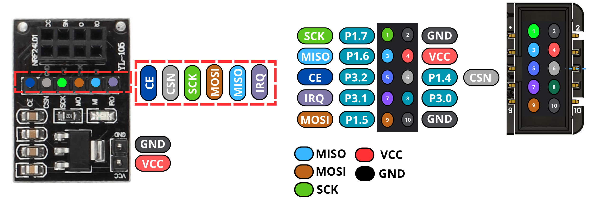

# USB2NRF: nRF24L01+ to USB CDC bridge

This CH552 example is based on the `nrf2cdc` firmware from [CH552-USB-NRF](https://github.com/wagiminator/CH552-USB-NRF) by **Stefan Wagner (wagiminator)**. The original source headers and credits are preserved.

The firmware provides a USB CDC serial port for sending and receiving nRF24L01+ radio payloads of up to 32 bytes. This example contains its own sources, upload tool, license, and connector pinout; it does not depend on a separate upstream checkout.

## Hardware

The functional wiring follows the supplied 2 × 5 connector diagram:



Viewed from the connector face as shown above, pin 1 is at the upper left and pin 2 at the upper right:

| Left contact | Function and CH552 signal | Right contact | Function and CH552 signal |
| --- | --- | --- | --- |
| 1 | SCK — P1.7 | 2 | GND |
| 3 | MISO — P1.6 | 4 | VCC |
| 5 | CE — P3.2 | 6 | CSN — P1.4 |
| 7 | IRQ — P3.1 | 8 | P3.0 activity output |
| 9 | MOSI — P1.5 | 10 | GND |

The six radio signals connect to the corresponding CE, CSN, SCK, MOSI, MISO, and IRQ contacts on the nRF24L01+ adapter. VCC and both GND contacts provide its power connections. The firmware pin definitions in [`src/config.h`](src/config.h) already match this mapping and use a 16 MHz internal clock. P3.0 is driven as an active-low activity output by the original firmware; it only controls an LED if one is connected to that contact.

The connector table and image above are the wiring reference for this example. With another connector layout, follow the CH552 signal names rather than these contact numbers; P1.5, P1.6, and P1.7 are the fixed SPI pins used by this firmware.

## Build

From the SDK root, build with the Docker based `spkg` tool:

```bash
./spkg/spkg -p ./examples/usb/usb_nrf/nrf2cdc bin
```

The output is `examples/usb/usb_nrf/nrf2cdc/build/main.bin`. You can also build with a locally installed SDCC toolchain:

```bash
make -C examples/usb/usb_nrf/nrf2cdc bin
```

Or use PlatformIO:

```bash
./spkg/spkg pio ./examples/usb/usb_nrf/nrf2cdc run
```

PlatformIO writes `firmware.bin` to `.pio/build/unit_ch552/` within this example.

## Upload and use

Put the CH552 into bootloader mode by holding **BOOT** while connecting USB. Then upload the binary with the included tool:

```bash
python3 examples/usb/usb_nrf/nrf2cdc/tools/chprog.py \
  examples/usb/usb_nrf/nrf2cdc/build/main.bin
```

`chprog.py` requires Python 3 and PyUSB. You can also run `make flash` from this example's directory, or use `./spkg/spkg pio ./examples/usb/usb_nrf/nrf2cdc run -t upload` with the SDK's configured uploader. The device must be in bootloader mode when uploading starts.

After flashing, open the USB CDC serial port. The serial monitor's baud rate does not affect the USB connection. Text sent to the port is transmitted over the radio, and received packets appear in the monitor. Both radios must use the same channel and data rate; one radio's TX address must match the other's RX address.

Commands start with `!`:

| Command | Effect |
| --- | --- |
| `!` | Show the current settings. |
| `!c2A` | Set channel `0x2A` (range `00` to `7F`). |
| `!t7B271F1F1F` | Set the five byte TX address, least significant byte first. |
| `!r41C355AA55` | Set the five byte RX address, least significant byte first. |
| `!s02` | Set data rate: `00` = 250 kb/s, `01` = 1 Mb/s, `02` = 2 Mb/s. |
| `!oADLx` | Enable `A` auto ACK, `D` dynamic payload length, and `L` line ending removal; disable `x` hexadecimal mode. Uppercase enables and lowercase disables each option. |

Configuration changes are stored in the CH552 data flash and survive a restart. See the [original README](https://github.com/wagiminator/CH552-USB-NRF#nrf-to-cdc) for more protocol details.

## Origin and licenses

- **Firmware:** Stefan Wagner, [CH552-USB-NRF](https://github.com/wagiminator/CH552-USB-NRF), revision `845308234d6c2fce05ce4d6ec156a478205986f8`. Licensed under **Creative Commons Attribution-ShareAlike 3.0 Unported (CC BY-SA 3.0)**; see [`LICENSE`](LICENSE) and the [license text](https://creativecommons.org/licenses/by-sa/3.0/).
- **Functional connector pinout and image:** Supplied by the project contributor. The connector table records that diagram's contact numbers and signal mapping.
- **SDK adaptation:** César Bautista. The firmware was integrated as `main.c` and `src/`, with a project `Makefile`, `platformio.ini`, and this documentation. The firmware changes reserve one extra byte for the command terminator, initialize the character used after an empty packet, and reject invalid payload lengths before copying into the buffer. These firmware changes are distributed under the same **CC BY-SA 3.0** license.
- **`tools/chprog.py`:** Stefan Wagner. This upload tool retains the **MIT** license stated in its header; see [`tools/LICENSE`](tools/LICENSE).

The SDK root's MIT license covers its own tools and structure. The firmware retains its CC BY-SA 3.0 license.
